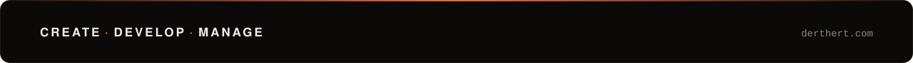

### 👋 Merhaba, ben Emirhan

İstanbul'da bağımsız çalışan bir yazılım geliştiricisi ve sistem mimarıyım. 
Web platformları, backend servisleri, masaüstü uygulamalar 
ve oyun sunucusu altyapıları geliştiriyorum.

Her işe net bir planla başlarım. Benim için çalışan kod yeterli değil; 
okunabilir, test edilebilir ve uzun vadede sürdürülebilir olmalı.

Bir yapı ihtiyacı karşılamıyorsa onu yamamak yerine 
doğru temeller üzerine yeniden kurmayı tercih ederim.

Çalışmalarımın çoğu müşterilere özel ve kapalı kaynak.

 

English

I'm an independent software developer and systems architect based in Istanbul. 
I build web platforms, backend services, desktop applications 
and game server infrastructure.

I start every project with a clear plan. Working code isn't enough for me; 
it has to be readable, testable and maintainable in the long run.

When a system doesn't fit the need, I'd rather rebuild it 
on the right foundations than patch it.

Most of my work is client-specific and closed-source. Visit <a href="https://derthert.com">derthert.com</a> for more.

